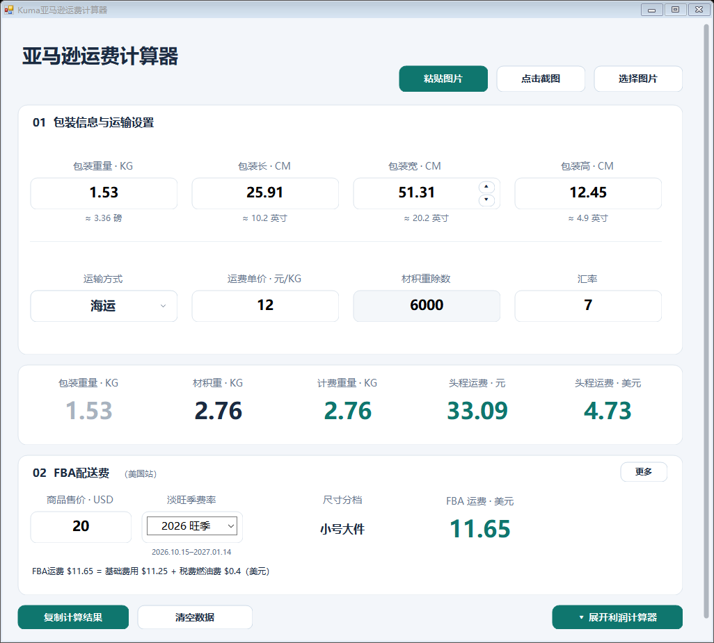
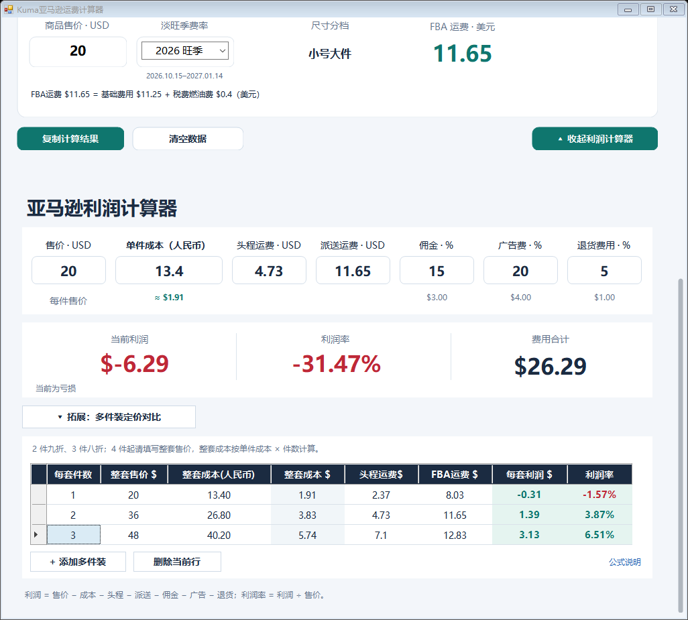

# Kuma亚马逊运费计算器

**版本：1.0 · Copyright © 2026 Kuma**

## 下载即用

**[下载 Windows 版 EXE（约 31 MB）](https://github.com/tilorfang/Kuma-Amazon-Calculator/releases/download/v1.0/Kuma-Amazon-Calculator-1.0.exe)** · [查看发行版](https://github.com/tilorfang/Kuma-Amazon-Calculator/releases/tag/v1.0)

下载后双击 EXE 即可使用，无需编译、无需安装 Python 或另行下载 OCR 模型。适用于 Windows 10/11 64 位，需要 .NET Framework 4.8。


亚马逊运费与利润计算器，支持离线 OCR 识图。

- **三种图片获取方式**：粘贴图片（Ctrl+V）、框选屏幕截图、选择本地图片。自动识别售价、包装尺寸和重量，识别后可手动核对修改。
- **自动计算计费重量**：计算实重与材积重，自动取较大值计算头程运费，支持海运、空运和快递设置。
- **输入成本自动计算利润**：联动售价、头程、FBA、汇率、佣金、广告和退货费用，计算利润及利润率。
- **多件装同步计算**：按件数同步计算包装、成本、运费、FBA 和利润，支持手动调整整套售价及成本。

## 界面演示

### 运费计算



### 利润与多件装计算



*图中为示例输入，仅用于展示界面。*

## 使用与构建

源码包含离线 OCR 模型、运行依赖及第三方许可。

构建还需要 Python 3和系统 C# 编译器。在仓库目录运行：

```powershell
powershell.exe -NoProfile -ExecutionPolicy Bypass -File .\build-single.ps1
```

生成 `Kuma亚马逊运费计算器.exe`，可单文件复制运行；使用程序不需要安装 Python。

## 说明

OCR 结果请人工核对。内置 FBA 为固定 2026 年美国-非服装参考费率，并非实时费用；运费、汇率和费用比例可按实际情况调整。多件装默认按单件包装的宽度及重量乘件数、长高不变计算，需核对实际整套包装。默认两件装售价九折、三件装八折，四件起需手动填写售价。

Copyright © 2026 Kuma。第三方组件和模型的版权及许可见 `payload/licenses/`。
